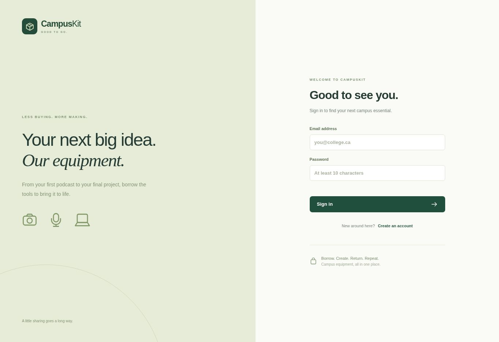
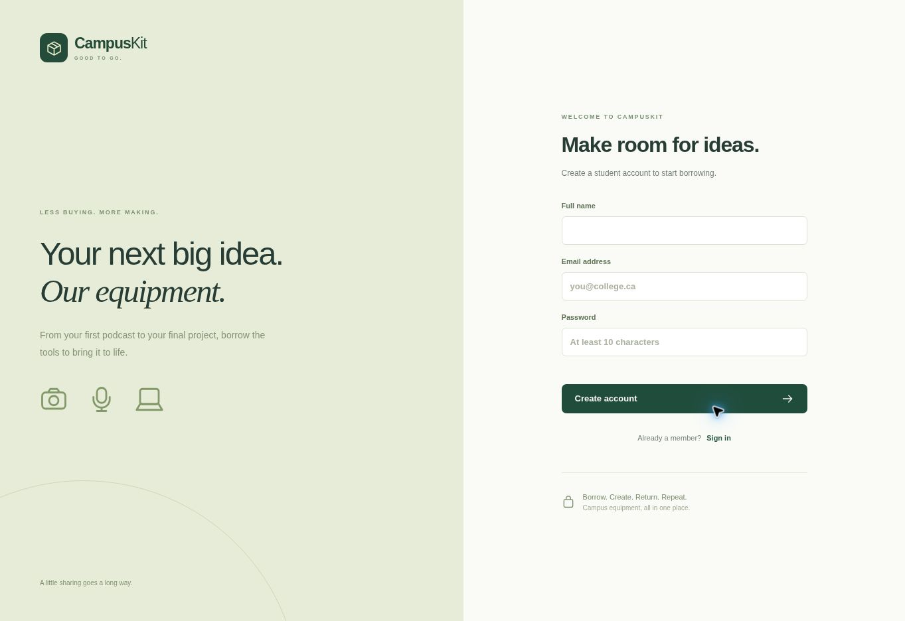

# CampusKit External Design Document v1 - DRAFT
COMP229 - Web Application Development | Project Part 1
Team members/student IDs: [Required, 4-6 actual members]
Repository/board/video URLs: [Required]

## Contents
1. Purpose and scope
2. Architecture and collections
3. Student wireframes
4. Staff and account wireframes
5. Initial sign-in screenshot
6. Initial registration screenshot
7. Verification and next steps

## Purpose and scope
Campus equipment lending. Students browse individually tracked assets and submit borrowing requests; staff manage inventory, decide requests, and record physical returns. One record is one physical item. Pending requests do not reserve an asset. Part 1 excludes calendar reservations, fines, renewals, email recovery and single sign-on.

## Architecture and collections
React view, Express routes/middleware/controllers, Mongoose models, MongoDB persistence. Vite uses 5001; API uses 5002. Collections: users (name, email, hash, role, tokenVersion), equipment (name, category, unique assetTag, location, description, status, activeRequest), borrowrequests (user/equipment references, snapshots, dueDate, purpose, status, decisionNote). One user and asset each have many historical requests; an asset has at most one active approved request. See API_REFERENCE.md for endpoints and access rules.

## Wireframes
See the PDF's labelled student collection/borrowing and staff inventory/account diagrams. These are plans, not executed workflow screenshots.

## Initial screenshots

Captured from the built frontend in a static browser preview. No successful database-backed browser login is claimed. Add authenticated and mobile screenshots after local testing.

## Verification and next steps
See VERIFICATION.md for exact test outcomes. Review the multi-document failure limitation in README.md. Complete the real team details, signed contract, GitHub history, actual task board snapshot, two-slide deck and 5-10 minute video; add all actual URLs. Follow the completion checklist in START_HERE.md. Official technical references are in README.md.
